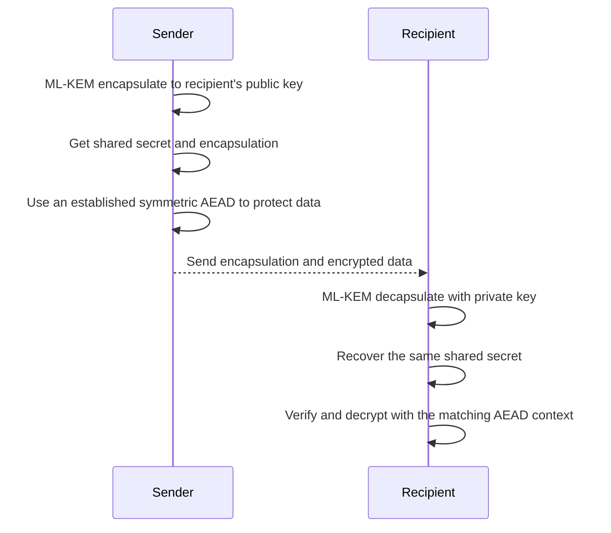

# How a KEM fits into hybrid encryption

A key encapsulation mechanism (KEM) helps two sides derive the same shared secret over a public channel. The sender creates an encapsulation using the recipient's public key; the recipient uses the matching private key to recover the same secret. The secret can then supply key material to symmetric authenticated encryption.

This diagram is conceptual. A real protocol must specify exact algorithms, parameters, key derivation, authentication, nonce handling, message formats, and error behavior. ML-KEM alone does not authenticate who sent a message. Use a complete established protocol and implementation, not a custom assembly of primitives.

For a standardized hybrid design that combines a KEM, key derivation function, and authenticated encryption, see [RFC 9180: HPKE](https://www.rfc-editor.org/rfc/rfc9180). Consult NIST's [PQC standards and migration page](https://csrc.nist.gov/projects/post-quantum-cryptography) for the latest standardization information.
